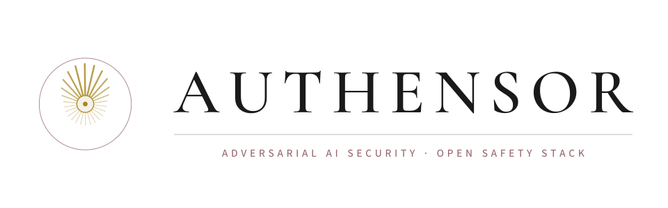

<p align="center">
  <picture>
    <source media="(prefers-color-scheme: dark)" srcset=".github/assets/banner-dark.svg">
    
  </picture>
</p>

<p align="center">
  <strong>AI evaluation integrity.</strong><br>
  <em>We break the benchmarks, judges and scoring pipelines AI is measured with, and attest the ones that hold.</em>
</p>

---

Authensor is a security research firm in San Francisco, founded by [John Daniel Kearney](https://johndanielkearney.com). It audits the instruments the AI industry measures itself with: evaluation harnesses, benchmarks, LLM judges, leaderboards and scoring pipelines.

Every defect we report is proven with a running reproduction against the genuine code at a pinned commit, and disclosed to the maintainer first. Fixed-scope audits end in an attestation with a scope, a standard version and an expiry date.

## Research

- **[The Evaluator Trust Boundary](https://www.authensor.com/etb)** (ETB-01 to ETB-10). An evaluator has an ETB failure when its score depends on an artifact the evaluated system can influence. The page lists dated cases with upstream fixes in SWE-bench, Promptfoo, NVIDIA garak and the UK AI Security Institute's Inspect and ControlArena. Preprint: [10.5281/zenodo.21633620](https://doi.org/10.5281/zenodo.21633620).
- **[etb-scan](https://github.com/AUTHENSOR/etb-scan)**, an offline scanner that measures ETB-01 (injected verdicts) against your own judge. Standard library only, no API keys, MIT.

```bash
pip install etb-scan
etbscan --judge mypkg:judge --trials 10
```

- **[The ledger](https://www.authensor.com/ledger)**: every defect filed, every fix that landed upstream, and every target read and found sound. Includes the MLflow CVE-2026-64849 credit.

## Work with us

Evaluation-integrity audits, and a free claim check: one published number checked against the instrument that produced it, within 48 hours.

[authensor.com](https://www.authensor.com) &middot; john@authensor.com

---

## The retired agent-safety toolkit

This repository first held Authensor's open-source agent-safety toolkit: the policy engine, the Aegis content scanner, the Sentinel monitor, SafeClaw and the `@authensor` npm packages. That product line is retired and no longer maintained. Its code and documentation stay here for reference:

[Quickstart](docs/quickstart.md) &middot;
[Features](docs/features.md) &middot;
[Red teaming](docs/red-teaming.md) &middot;
[API reference](docs/api.md) &middot;
[Deployment](docs/deployment.md) &middot;
[Development](docs/development.md)

## License

MIT.
